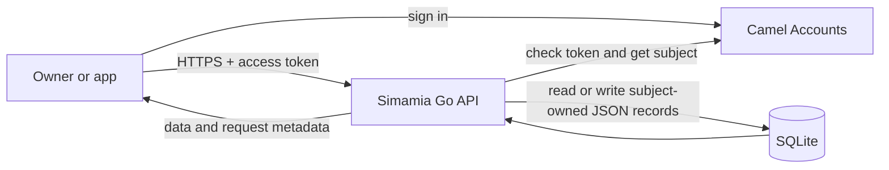
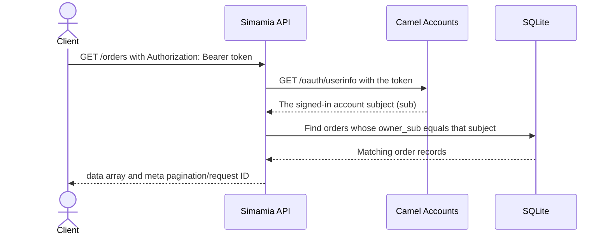

# How the Simamia API works

This page is a reading guide for people who want to understand the API before integrating it. It explains what happens when a request arrives, what the records mean, and how the usual service workflow fits together.

## The short version

Simamia has a web app and a Go API. The web app signs a user in with Camel Accounts. When the app asks the API for business data, it sends a Camel Accounts **access token**. The API checks that token with Camel Accounts, gets the account's stable subject ID, then reads or changes SQLite records owned by that subject.

An ordinary service workflow uses three kinds of records:

1. A **customer** records who the business serves.
2. A **service** describes work the business offers and its price.
3. An **order** records a particular piece of work, its customer and service names, its status, and money due or paid.

The API also stores a business profile, team directory entries, and expenses. Its `/payments` endpoint calculates balances from orders; it is not a payment processor.



## 1. Understand the address and version

All API routes begin with a base URL:

| Where you run it | Base URL |
| --- | --- |
| Local development | `http://localhost:8080/api/v1` |
| Production | `https://api.simamia.online/api/v1` |

`/api/v1` is the versioned part. A route such as `GET /customers` means the full local address is `http://localhost:8080/api/v1/customers`.

The API is organized around **resources** (collections of records):

| Resource | What a record means | Example ID |
| --- | --- | --- |
| `businesses` | A profile selected or entered during onboarding | `BIZ-0001` |
| `customers` | A customer contact | `CUS-0087` |
| `services` | A catalog item offered by the business | `SRV-03` |
| `orders` | A job, appointment, repair ticket, cleaning order, or other work unit | `ORD-0249` |
| `team` | A team directory entry | `TM-0005` |
| `expenses` | A recorded business cost | `EXP-0001` |
| `payments` | A calculated balance row for an order; read-only | `PAY-0249` |

IDs are generated by the API. Keep and reuse the returned `data.id` when reading, updating, or deleting a record.

## 2. Know what happens to each request

Most calls follow this sequence:



`GET /health` is the one public endpoint. Every business-data endpoint needs an access token. If the token is missing or invalid, the API responds with `401 UNAUTHORIZED`. If Camel Accounts cannot be reached, the API responds with `503 AUTH_UNAVAILABLE`.

### What “owned by this account” means

Each saved record has an `owner_sub` value taken from Camel Accounts. Lists show only that subject's rows. If you request another account's record ID, the API responds as if it does not exist (`404 NOT_FOUND`).

The current ownership boundary is the **signed-in account**, not a business profile. The API does not yet share data with other staff accounts or enforce team roles. Creating two business profiles under one account does not create separate data partitions: the account's customers, orders, team, services, and expenses remain in the same account-owned collections.

## 3. Read a response

Successful responses always have a `data` field and a `meta` field. `data` is usually an object for one record, an array for a collection, or a small result object for deletion.

For example, listing customers returns:

```json
{
  "data": [
    {
      "id": "CUS-0087",
      "owner_sub": "account-subject",
      "name": "Asha Mushi",
      "phone": "+255 712 345 678"
    }
  ],
  "meta": {
    "request_id": "req_...",
    "timestamp": "2026-10-11T08:00:00Z",
    "pagination": {
      "page": 1,
      "page_size": 20,
      "total": 1,
      "total_pages": 1
    }
  }
}
```

`request_id` helps identify a particular call in logs and support conversations. The API accepts an optional `X-Request-ID` header; if you omit it, the API generates one. The ID is echoed in the response header and JSON metadata; CORS exposes the response header to the Simamia app. List calls include pagination metadata even when the result is empty.

Errors use a different shape: `error.code` is the value your integration should use to decide what happened; `error.message` is for people diagnosing it. Empty editable collection results report `total: 0` and `total_pages: 0`; `/payments` is a special case and reports `total_pages: 1` even when empty.

## 4. Create the records for a business workflow

The most useful first workflow is to create a customer, a service, then an order. In these examples, set your base URL and access token first:

```bash
export SIMAMIA_API='http://localhost:8080/api/v1'
export SIMAMIA_TOKEN='your-Camel-Accounts-access-token'
```

### Add a customer

```bash
curl -X POST "$SIMAMIA_API/customers" \
  -H "Authorization: Bearer $SIMAMIA_TOKEN" \
  -H 'Content-Type: application/json' \
  -d '{"name":"Asha Mushi","phone":"+255 712 345 678","location":"Kinondoni"}'
```

The API requires a non-empty `name` and `phone`, assigns a `CUS-...` ID, and saves the record for the token's account. Save the returned ID if you need to open this customer directly later.

### Add a service

```bash
curl -X POST "$SIMAMIA_API/services" \
  -H "Authorization: Bearer $SIMAMIA_TOKEN" \
  -H 'Content-Type: application/json' \
  -d '{"name":"Wash and fold","category":"Laundry","duration":"24 hours","price":25000}'
```

The API requires a non-empty `name` and a `price` greater than zero. If you omit `currency` and `active`, the API adds `TZS` and `true`.

### Open an order

```bash
curl -X POST "$SIMAMIA_API/orders" \
  -H "Authorization: Bearer $SIMAMIA_TOKEN" \
  -H 'Content-Type: application/json' \
  -d '{"customer":"Asha Mushi","phone":"+255 712 345 678","service":"Wash and fold","date":"2026-10-12T09:00:00+03:00","amount":25000,"assignee":"Owner"}'
```

The API requires a non-empty `customer`, non-empty `service`, and `amount` greater than zero. It supplies `status: "New"`, `paid: 0`, and `currency: "TZS"` if you omit them.

**Important:** the order uses the customer and service names as text. It does not store required `customer_id` or `service_id` relationships. Keep names consistent in your app if you want the order to match what users see in those other screens.

The whole flow looks like this:

```mermaid
flowchart TD
  CreateCustomer[POST /customers\nname and phone] --> SaveCustomer[(Customer record)]
  CreateService[POST /services\nname and positive price] --> SaveService[(Service record)]
  SaveCustomer --> CreateOrder[POST /orders\ncustomer name + service name + amount]
  SaveService --> CreateOrder
  CreateOrder --> New[Order status defaults to New\npaid defaults to 0]
  New --> Progress[PATCH /orders/{id}\nchange status while work proceeds]
  Progress --> Complete[PATCH /orders/{id}\nset final status and paid amount]
  Complete --> Ledger[GET /payments\ncalculate amount - paid]
```

## 5. Move work forward and update money recorded

An order is the record the app uses for a job or other unit of work. Update it with `PATCH /orders/{id}` as its status or paid amount changes:

```bash
curl -X PATCH "$SIMAMIA_API/orders/ORD-0249" \
  -H "Authorization: Bearer $SIMAMIA_TOKEN" \
  -H 'Content-Type: application/json' \
  -d '{"status":"In progress"}'

curl -X PATCH "$SIMAMIA_API/orders/ORD-0249" \
  -H "Authorization: Bearer $SIMAMIA_TOKEN" \
  -H 'Content-Type: application/json' \
  -d '{"status":"Ready","paid":10000,"method":"M-Pesa"}'
```

A patch is a **shallow merge**. Sending just `status` changes that property and preserves the other order fields. The API accepts status labels as strings; it does not require a particular order of states. The app's templates provide the labels, while the API currently does not enforce template rules.

The `paid` field means “amount the app currently records as paid.” The API does not contact a mobile-money provider, verify a transaction, or create an independent payment record. Only update it after your own trusted payment confirmation.

## 6. Understand the payment balance view

`GET /payments` reads the signed-in account's orders and makes one response row per order:

```text
due = order.amount - order.paid
status = "paid" if order.paid >= order.amount; otherwise "pending"
```

So if an order is `amount: 25000` and `paid: 10000`, `/payments` reports `due: 15000` and `status: "pending"`. The row ID is derived from the order ID. There is no `POST /payments`: update the order's `paid` and `method` fields instead. `GET /payments` currently returns all those rows without pagination or filters.

## 7. Record an expense separately

An expense is a business outflow, such as rent or supplies. It is not a payment record and does not change an order balance.

```bash
curl -X POST "$SIMAMIA_API/expenses" \
  -H "Authorization: Bearer $SIMAMIA_TOKEN" \
  -H 'Content-Type: application/json' \
  -d '{"description":"Detergent","category":"Supplies","amount":85000,"date":"2026-10-11","method":"Cash"}'
```

The API requires non-empty `description`, `category`, and `date`, and a positive `amount`. The date is stored as text and is not parsed. Expense records do not automatically get subtracted from payments; a report must fetch and aggregate each collection.

## 8. Learn the collection routes

The six editable collections use the same basic actions:

| Action | Request | What it does |
| --- | --- | --- |
| List | `GET /{resource}` | Returns this account's records, with optional search and pagination. |
| Create | `POST /{resource}` | Creates one record and returns its generated ID. |
| Read | `GET /{resource}/{id}` | Returns one record owned by this account. |
| Update | `PATCH /{resource}/{id}` | Merges changed fields into that record. |
| Delete | `DELETE /{resource}/{id}` | Permanently removes it; there is no undo or archive. |

The collection names are `businesses`, `customers`, `services`, `orders`, `team`, and `expenses`. The exception is `payments`: it supports only `GET /payments`.

### Search and pagination

For list routes, `q` does a case-insensitive text search through the serialized record, `status` does an exact and case-sensitive match, and `page`/`page_size` control pagination. Filters run before pagination, results are newest first, and there are no sort, date-range, or category filters. `status` has no effect on a resource whose records have no `status` property. `/payments` ignores these query parameters and returns all derived rows:

```bash
curl --get "$SIMAMIA_API/orders" \
  -H "Authorization: Bearer $SIMAMIA_TOKEN" \
  --data-urlencode 'q=Asha' \
  --data-urlencode 'status=Ready' \
  --data-urlencode 'page=1' \
  --data-urlencode 'page_size=20'
```

Defaults are page `1` and page size `20`. Invalid values fall back to those defaults; page sizes over `100` are capped to `100`. Search and status filtering happen before pagination.

## 9. Choose the right guide for the next step

- [Getting started](/getting-started): configure your local API and make the first calls.
- [Authentication](/concepts/authentication): understand Camel Accounts and account ownership.
- [Request validation](/concepts/validation): see exactly which values the API checks on create and update.
- [API reference](/api): the full endpoint list and resource guides.
- [Swagger UI](/api/swagger): inspect schemas and use “Try it out.”
- [Responses and errors](/concepts/responses-errors): understand HTTP statuses and retry handling.
- [Create and complete a job](/workflows/create-and-complete-job): a shorter operational walkthrough.
- [Current limits](/operations/limits): understand what the API does not enforce or integrate with yet.
- [HTTP behavior](/operations/http-behavior): routing, CORS, request IDs, headers, and server timeouts.

The same contract is available as the [OpenAPI YAML file](/openapi.yaml). Use the narrative guides to understand behavior and that file when a tool needs a machine-readable API schema.
