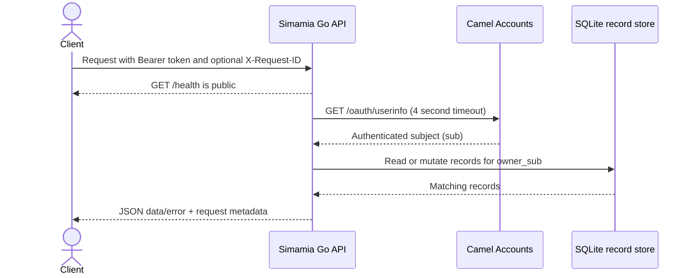

import { Cards } from 'nextra/components'

# API reference

New to the API? Start with [How the API works](/api/how-it-works) for the concepts and a complete walkthrough. Use this page as the endpoint map, then open [Swagger UI](/api/swagger) when you need exact request schemas.

## Base URLs

| Environment | Base URL |
| --- | --- |
| Local | `http://localhost:8080/api/v1` |
| Production | `https://api.simamia.online/api/v1` |

All paths below are relative to the base URL. For example, production health is `https://api.simamia.online/api/v1/health`.

## Endpoint index

| Collection | List | Create | Read one | Update | Delete |
| --- | --- | --- | --- | --- | --- |
| `businesses` | `GET /businesses` | `POST /businesses` | `GET /businesses/{id}` | `PATCH /businesses/{id}` | `DELETE /businesses/{id}` |
| `customers` | `GET /customers` | `POST /customers` | `GET /customers/{id}` | `PATCH /customers/{id}` | `DELETE /customers/{id}` |
| `services` | `GET /services` | `POST /services` | `GET /services/{id}` | `PATCH /services/{id}` | `DELETE /services/{id}` |
| `orders` | `GET /orders` | `POST /orders` | `GET /orders/{id}` | `PATCH /orders/{id}` | `DELETE /orders/{id}` |
| `team` | `GET /team` | `POST /team` | `GET /team/{id}` | `PATCH /team/{id}` | `DELETE /team/{id}` |
| `expenses` | `GET /expenses` | `POST /expenses` | `GET /expenses/{id}` | `PATCH /expenses/{id}` | `DELETE /expenses/{id}` |
| `payments` | `GET /payments` | — | — | — | — |
| health | `GET /health` | — | — | — | — |

The private operator surface is documented separately at [Private admin API](/api/admin); those routes use a server-only admin key and are intended for the Simamia admin service.

The six resource collections (`businesses`, `customers`, `services`, `orders`, `team`, `expenses`) each support all five collection and item operations shown above. `payments` is read-only. `GET /health` is public; every other operation requires a Camel Accounts access token.

## Interactive reference and downloadable contract

Open the [Interactive Swagger UI](/api/swagger) to browse every request, schema, response, and status code. The same [OpenAPI 3.1 YAML](/openapi.yaml) can be imported into Swagger Editor, Postman, Insomnia, or a client generator. The source of truth is [`api/openapi.yaml`](https://github.com/troubleman96/SIMAMIA/blob/main/api/openapi.yaml) in the Simamia repository.

## Request lifecycle



## Main service workflow

```mermaid
flowchart LR
  Profile[Business profile\nPOST /businesses] --> Customer[Customer\nPOST /customers]
  Profile --> Service[Service catalog\nPOST /services]
  Customer --> Order[Work order\nPOST /orders]
  Service --> Order
  Order --> Status[Progress updates\nPATCH /orders/{id}]
  Status --> Paid[Update amount paid\nPATCH /orders/{id}]
  Paid --> Ledger[Derived balance\nGET /payments]
  Profile --> Team[Team directory\nPOST /team]
  Profile --> Expense[Expense record\nPOST /expenses]
```

This describes the app's typical sequence, not enforced database relationships: an order stores customer and service names as text. The API does not require a business profile before accepting other records, and business/template membership is not a foreign key.

## Resource contracts at a glance

| Resource | Required on create | Server defaults / behavior |
| --- | --- | --- |
| `businesses` | No resource-specific required fields | App uses `businessName`, `phone`, `primaryTemplate`; API accepts an arbitrary object. |
| `customers` | `name`, `phone` | No phone normalization, uniqueness, or customer-to-order relationship. |
| `services` | `name`, `price > 0` | `currency: TZS`, `active: true`. |
| `orders` | `customer`, `service`, `amount > 0` | `currency: TZS`, `status: New`, `paid: 0`; other workflow fields are flexible. |
| `team` | `name`, `phone` | Directory only; role values do not grant permissions. |
| `expenses` | `description`, `category`, `amount > 0`, `date` | Date is stored as provided and is not parsed. |
| `payments` | — | Derived from owned orders and read-only. |

Amounts are numeric values intended to be TZS. The API validates that required order/service/expense amounts are greater than zero, but does **not** enforce `paid <= amount` or verify that a payment occurred.

## Common headers

| Header | Required | Description |
| --- | --- | --- |
| `Authorization: Bearer <token>` | For all routes except health | Camel Accounts OAuth access token |
| `Accept: application/json` | Recommended | Requests JSON responses |
| `Content-Type: application/json` | For POST/PATCH | One JSON object, maximum size 1 MiB |
| `X-Request-ID` | Optional | Caller correlation identifier; generated if omitted |

## Common list query parameters

`GET /{resource}` supports:

| Parameter | Default | Behavior |
| --- | --- | --- |
| `q` | empty | Case-insensitive substring search across the JSON representation of each owned record |
| `status` | empty | Exact string comparison with the record's `status` property |
| `page` | `1` | Positive, one-based page. Invalid values use the default. |
| `page_size` | `20` | Positive page size. Invalid values use the default; values over 100 are capped at 100. |

The payment endpoint does not currently use these filters; it returns all derived ledger rows for the account.

## Generic item lifecycle

### Create

`POST /{resource}` accepts a resource-specific JSON object. The server ignores a supplied ID and generates one. It also assigns the authenticated subject as `owner_sub`.

### Read and update

Use the returned ID with `GET /{resource}/{id}` or `PATCH /{resource}/{id}`. A patch merges the provided keys into the existing object, then validates the merged record. Omitted fields are preserved. You cannot change the ID or ownership fields.

### Delete

`DELETE /{resource}/{id}` permanently removes the row and returns `{ "id": "...", "deleted": true }`. There is no soft-delete or undo endpoint.

See [responses and errors](/concepts/responses-errors), then choose a resource:

<Cards>
  <Cards.Card title="Businesses" href="/api/businesses">Create and manage the onboarding profile.</Cards.Card>
  <Cards.Card title="Customers" href="/api/customers">Maintain account-owned customer contacts.</Cards.Card>
  <Cards.Card title="Services" href="/api/services">Manage the service catalog and prices.</Cards.Card>
  <Cards.Card title="Orders" href="/api/orders">Track work, status, assignments, and paid amounts.</Cards.Card>
  <Cards.Card title="Team" href="/api/team">Maintain team directory records.</Cards.Card>
  <Cards.Card title="Expenses" href="/api/expenses">Record and query operating costs.</Cards.Card>
  <Cards.Card title="Payment ledger" href="/api/payments">Read balances derived from orders.</Cards.Card>
</Cards>

## OpenAPI contract

The versioned OpenAPI 3.1 contract is maintained in the Simamia repository at [`api/openapi.yaml`](https://github.com/troubleman96/SIMAMIA/blob/main/api/openapi.yaml) and mirrored as a [downloadable YAML file](/openapi.yaml). The resource guides explain runtime behavior, defaults, validation limits, and safe usage patterns that are easy to miss from schemas alone.
