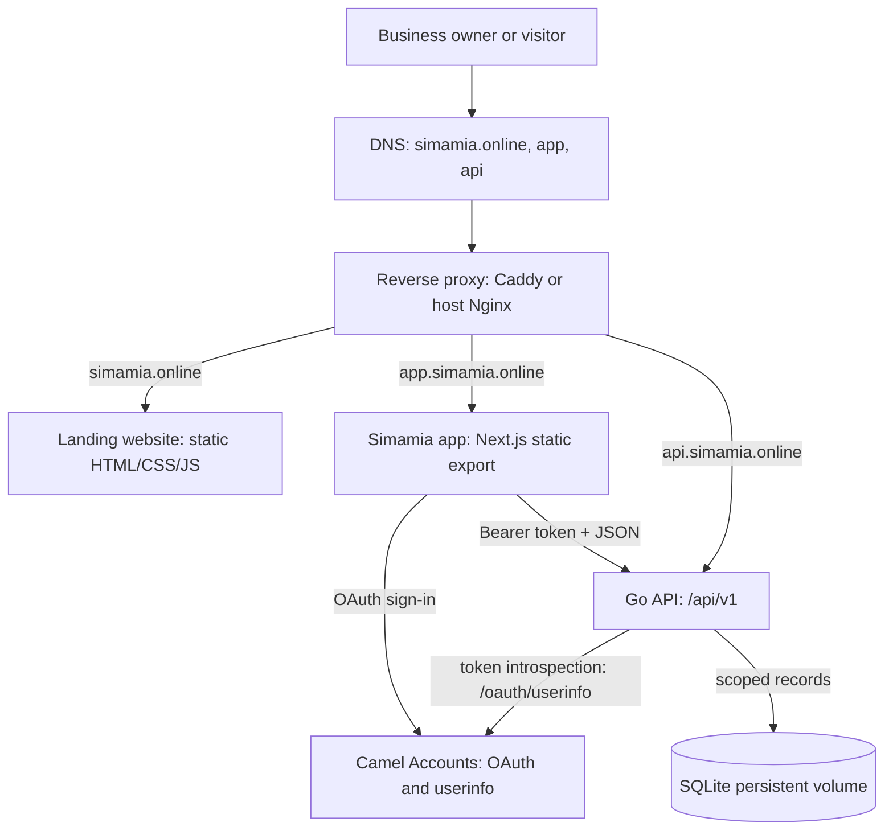
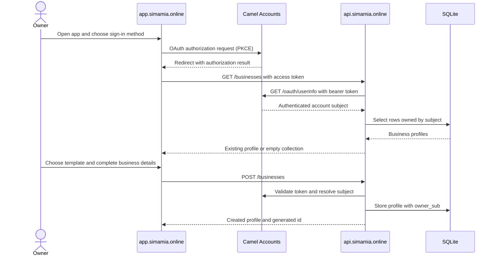
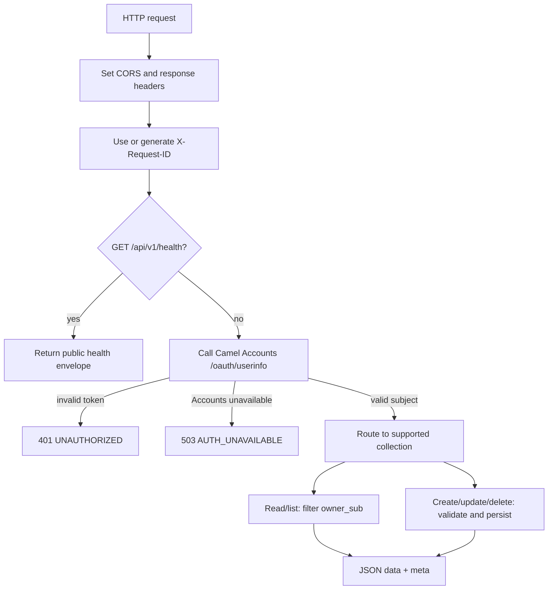

# Architecture

## Production services

The production stack has three product services and a reverse proxy. The landing site and app are static web assets in Nginx containers. The Go API is a separate service and persists data in a named SQLite volume. Caddy terminates TLS in the standalone deployment; the existing VPS deployment uses host Nginx and loopback ports instead.

## Sign-in and first-use setup

The app uses a public Camel Accounts OAuth client. Phone/password and Google sign-in happen at Camel Accounts. The app receives the authorization result through its callback, then shows Simamia onboarding if the account has no business profile. Onboarding is two steps: choose one of eight business templates, then enter the business name and Tanzania phone number.

## API request handling

The Go handler sets CORS and security headers, assigns a request ID, answers `/health` without auth, then authenticates every other endpoint. It resolves the token's account subject using Camel Accounts userinfo and filters each data collection by that subject. SQLite writes use one connection and WAL mode.

## Tenant boundary today

The storage boundary is the Camel Accounts subject (`owner_sub`). Every stored record belongs to the account that created it; another subject cannot fetch, edit, delete, or list that record. The current model does not yet implement business-level membership: a shared shop with multiple staff accounts needs membership and role support before those accounts can safely share one business workspace.

## Important implementation constraints

- SQLite is single-server storage and API connections are limited to one open connection. Do not run multiple API replicas against the same database file.
- On a newly initialized empty database, example rows are seeded under `local-preview`; authenticated account requests are scoped to their own subject and will not see those rows.
- Orders refer to customers and services by display name strings, not enforced foreign keys.
- Payment ledger rows are calculated from `orders.amount` and `orders.paid` on each request. The ledger is not an independently writable table.
- Template selection lives in the business profile. The API does not enforce template-specific field schemas or state transitions yet.

See [data model](/concepts/data-model), [authentication](/concepts/authentication), and [production limits](/operations/limits) for details.
