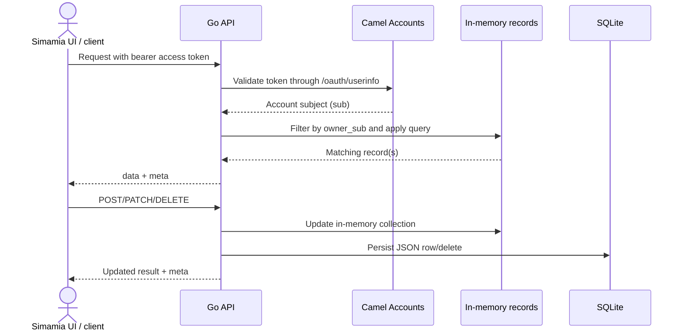

# Data model

## Record storage

The API stores flexible JSON objects in one SQLite `records` table. A row has a `resource`, generated `id`, JSON `payload`, and created/updated timestamps. The current response returns the stored payload; it does not expose those SQL timestamps unless a caller included similarly named properties in its input.

Each created record receives a server-generated `id` and `owner_sub`. The server overwrites caller-supplied `id` and `owner_sub` on create. Business profiles also receive the app-compatible `ownerSub` property set to the authenticated subject. On `PATCH`, the API removes `id`, `owner_sub`, and `ownerSub` from the patch. For other resource types, an `ownerSub` value sent during create is merely an extra JSON property; it is not used for access control.

## Resources and IDs

| Collection | Identifier prefix | Required on create | Defaults |
| --- | --- | --- | --- |
| `businesses` | `BIZ-0001` | None beyond a JSON object | Adds `owner_sub` and `ownerSub` |
| `customers` | `CUS-0001` | `name`, `phone` | None |
| `services` | `SRV-01` | `name`, positive `price` | `currency: TZS`, `active: true` |
| `orders` | `ORD-0001` | `customer`, `service`, positive `amount` | `currency: TZS`, `status: New`, `paid: 0` |
| `team` | `TM-0001` | `name`, `phone` | None |
| `expenses` | `EXP-0001` | `description`, `category`, positive `amount`, `date` | None |

IDs are generated per resource and per API database. They are stable for a record's lifetime but are not globally unique across separate environments. Use the full ID with the collection path, for example `GET /orders/ORD-0248`.

The API derives its next sequence from stored IDs when it starts. Services use a minimum two-digit sequence (`SRV-01`); the other prefixes use a minimum four-digit sequence (`CUS-0001`). These are display-friendly identifiers, not secure or secret tokens.

## Relationships are currently display values

Order `customer`, `service`, and `assignee` values are plain strings, typically names. The API does not verify that those strings refer to existing customer, service, or team records, and does not cascade changes or deletes. Integrations should keep names consistent until the backend introduces stable relationship IDs.

## Payment ledger

`GET /payments` reads owned orders and calculates one ledger line per order:

```text
due = amount - paid
status = "paid" when paid >= amount, otherwise "pending"
```

The response includes `id`, `order_id`, `customer`, `amount`, `paid`, `due`, `currency`, `method`, and `status`. The API copies the order's `method` value, so it can be `null` when no method was stored. A partially paid balance has status `pending`. The endpoint has no `POST`, `PATCH`, or `DELETE`; change an order's `paid` value through `PATCH /orders/{id}` to update its derived line. No provider transaction is created or confirmed by that patch.

## Workflow templates

The app's eight templates choose labels, states, and intake details during onboarding. Current API resources remain generic. The API does not validate the `primaryTemplate` against template-specific schemas, restrict status transitions, track service inventory, or enforce business-specific rules.

## Database isolation and demo seed

Production API rows are filtered by the authenticated account's Camel Accounts subject. A new empty SQLite database receives sample rows owned by the reserved subject `local-preview`; a normal signed-in user does not see those sample rows. The production database must be backed up and restored as one unit, and this SQLite setup supports a single API instance only.

At startup, all records are loaded from SQLite into in-memory slices. List, item lookup, search, and ownership filtering run against those slices; the SQL table is the durable store, not a query engine used for each read. Search scans each record's serialized JSON and has no database index. This is appropriate for a small single-instance MVP, but it limits growth.

The SQLite row also has `created_at` and `updated_at` columns. The API updates `updated_at` on a patch, but those SQL timestamps are not copied into response records. If a client sends JSON properties named `created_at` or `updated_at`, those are separate payload fields.

Existing legacy rows with no `owner_sub` are not automatically assigned to the current user. They remain invisible to authenticated account list and item requests until a deliberate migration assigns ownership.

## Read and write lifecycle



The API loads the SQLite rows into memory at startup. This means the current implementation is designed around one running process and one database file. It has no database transactions spanning multiple business records. A customer and an order are separate requests: if order creation fails after the customer was saved, the customer remains saved.

## Deletion and recovery behavior

`DELETE /{resource}/{id}` physically deletes the row and returns a small success result. There is no archive flag, soft deletion, undo window, or audit trail. If the UI needs a safe archive workflow, it must be implemented as a record property until the API gains explicit archive semantics. Back up the SQLite database before operational migrations or destructive maintenance.
