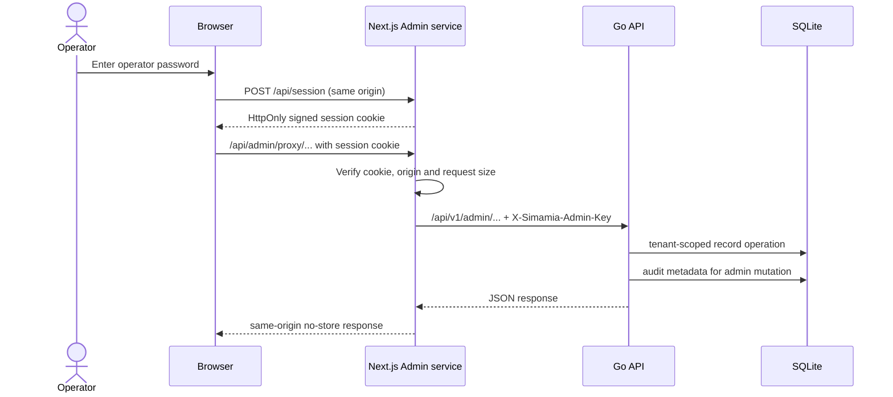

# Admin console deployment

The admin app is a separate Next.js server at `https://admin.simamia.online`, routed to the `admin` Compose service on port 3000. With the existing host Nginx setup, Compose binds it only to `127.0.0.1:4176` and `deploy/nginx-simamia.conf` proxies the admin hostname to that loopback port. DNS and a TLS certificate for `admin.simamia.online` are required.

## Server-only environment values

Configure these in the server `.env` file, never in a `NEXT_PUBLIC_*` variable:

```dotenv
SIMAMIA_ADMIN_PASSWORD=<private operator password>
SIMAMIA_ADMIN_API_TOKEN=<random key, 32 or more characters>
SIMAMIA_ADMIN_SESSION_SECRET=<different random secret, 32 or more characters>
SIMAMIA_ADMIN_ACTOR=platform-operator
ADMIN_APP_ORIGIN=https://admin.simamia.online
```

Set `SIMAMIA_ADMIN_API_TOKEN` on the admin service and as the API's `SIMAMIA_ADMIN_TOKEN`; Compose wiring does this. Generate independent values with `openssl rand -base64 36`. A missing/short Go admin key disables the API with `503 ADMIN_DISABLED`.

## Request flow



The session is valid for eight hours and is HttpOnly, SameSite=Strict, and Secure in production. The app checks the configured exact `ADMIN_APP_ORIGIN` on login and mutation requests. Failed logins are throttled in process memory; restarting the service resets that short-lived throttle.

## Deploy

```bash
docker compose -f compose.yaml -f deploy/compose.vps.yaml up -d --build admin api
sudo nginx -t && sudo systemctl reload nginx
```

Issue or update the TLS certificate through Certbot for the admin hostname after DNS points to this VPS. See the complete [Simamia deployment guide](/operations/deployment), [admin endpoint guide](/api/admin), and [OpenAPI contract](/openapi.yaml).

This console has one shared operator password and one shared actor label. The health page checks API/database connectivity but does not inspect container logs or call Camel Accounts for a live health probe. Camel Accounts identity credentials remain managed separately.
