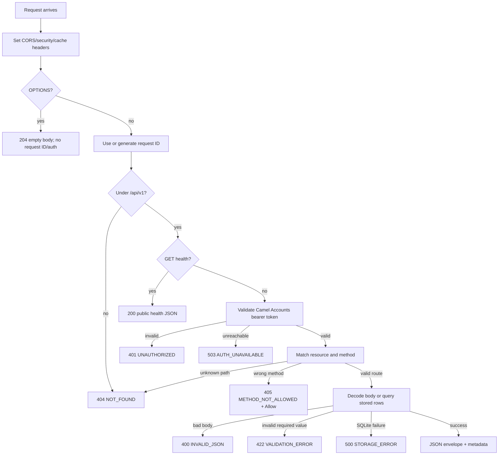

# HTTP request and response behavior

This page explains shared HTTP behavior around the resource endpoints. For request fields, see [request validation](/concepts/validation). For authentication outcomes, see [authentication](/concepts/authentication).

## Route matching and method handling

All routes are under `/api/v1`:

| Route shape | Supported methods |
| --- | --- |
| `/api/v1/health` | `GET` |
| `/api/v1/{collection}` for `businesses`, `customers`, `services`, `orders`, `team`, `expenses` | `GET`, `POST` |
| `/api/v1/{collection}/{id}` for those collections | `GET`, `PATCH`, `DELETE` |
| `/api/v1/payments` | `GET` |
| Any path receiving a browser preflight | `OPTIONS` returns `204` before route matching |

There is no API root/index route. `PUT`, `HEAD`, and unsupported methods receive `405 METHOD_NOT_ALLOWED`; the response includes an `Allow` header. The value is `GET, POST` for a collection, `GET, PATCH, DELETE` for an item, and `GET` for health or payments.

Method handling depends on the matched route. A `POST` to an item path is not the same as posting to a collection; it receives `405` with that item's supported methods. `GET /api/v1/health` is public, but using another method on `/health` receives `405` without Camel Accounts validation.

For a normal request, the API assigns or echoes a request ID, checks that the path starts with `/api/v1`, answers public health requests, authenticates data requests, then checks the resource and method. Because authentication occurs before resource lookup, a request to an unknown resource without a valid token can receive `401` before an authenticated request to that same path receives `404`.

## CORS and browser preflight

The server sets these headers on requests:

| Header | Value / purpose |
| --- | --- |
| `Access-Control-Allow-Origin` | `*` if `CORS_ALLOWED_ORIGINS` is unset or contains `*`; otherwise the request origin when it exactly matches an allowlist entry. |
| `Access-Control-Allow-Methods` | `GET, POST, PATCH, DELETE, OPTIONS`. |
| `Access-Control-Allow-Headers` | `Content-Type, Authorization, X-Request-ID`. |
| `Access-Control-Expose-Headers` | `X-Request-ID`, so browser clients can correlate app logs with API access logs. |
| `X-Content-Type-Options` | `nosniff`. |
| `Cache-Control` | `no-store`. |

When the server selects one exact allowed origin it also sends `Vary: Origin`. It does not enable credentialed cookie requests. The app's API calls use bearer tokens in the `Authorization` header.

An `OPTIONS` request returns immediately with `204 No Content`; this happens before route lookup and authentication. The configured allow-method and allow-header values are sent, but this early response does not receive an `X-Request-ID` or JSON envelope. A CORS preflight only indicates browser permission to attempt a request; it does not authenticate or authorize that request.

Production should set `CORS_ALLOWED_ORIGINS` to exact trusted origins, for example:

```env
CORS_ALLOWED_ORIGINS=https://app.simamia.online
```

Multiple entries are comma-separated. Matching includes scheme and host. CORS is not a restriction on non-browser clients.

## Common response headers

For JSON success and error responses, the API sets:

```http
Content-Type: application/json; charset=utf-8
X-Request-ID: req_...
Cache-Control: no-store
X-Content-Type-Options: nosniff
```

It also includes the request ID in `meta.request_id`. Cross-origin browser clients can read it from the `X-Request-ID` response header or the JSON metadata.

`timestamp` is generated in UTC using RFC 3339 with nanosecond precision when available. The health response's `time_zone` is business context (`Africa/Dar_es_Salaam`); it is not the timezone used for the metadata timestamp.

## Request IDs

Send a caller-generated, non-sensitive `X-Request-ID` to join the API response to your own logs. If absent or empty, the API generates an ID with prefix `req_` and 16 lowercase hexadecimal characters (eight random bytes); if secure random generation fails it uses a time-derived suffix. A non-empty caller value is echoed without format validation.

The API logs its generated request IDs with each access event. Caller-supplied IDs remain echoed by the API but are intentionally omitted from server logs; use the server-generated ID when correlating with API logs. `OPTIONS` is an exception: it returns before request ID generation.

## Timeouts and service health

The Go HTTP server is configured with:

| Setting | Duration | Meaning |
| --- | ---: | --- |
| `ReadHeaderTimeout` | 5 seconds | Maximum time to read request headers. |
| `ReadTimeout` | 15 seconds | Maximum time to read the request, including its body. |
| `WriteTimeout` | 15 seconds | Maximum time to write the response. |
| `IdleTimeout` | 60 seconds | Keep-alive connection idle limit. |

Token validation separately gives Camel Accounts userinfo a four-second context timeout. SQLite uses a 5-second busy timeout. A request may therefore fail because of the API server deadline, Camel Accounts availability, or a database lock.

`GET /health` is a process liveness response. It returns static service/version/timezone/currency values; it does not ping SQLite, check write capability, or call Camel Accounts. The container health check uses this endpoint, so `healthy` means the HTTP process responded, not that every dependency is ready.

## Request body parsing

`POST` and `PATCH` bodies are decoded as one JSON object. The API does not use the `Content-Type` header to choose a decoder and does not support form data, multipart uploads, arrays, or streaming bodies. Keep JSON bodies below 1 MiB. Malformed bodies return `400 INVALID_JSON` with the parser error message; a second JSON value or a non-object value also returns `400`.

## Error timing



See [responses and errors](/concepts/responses-errors) for the full error table and client behavior.
