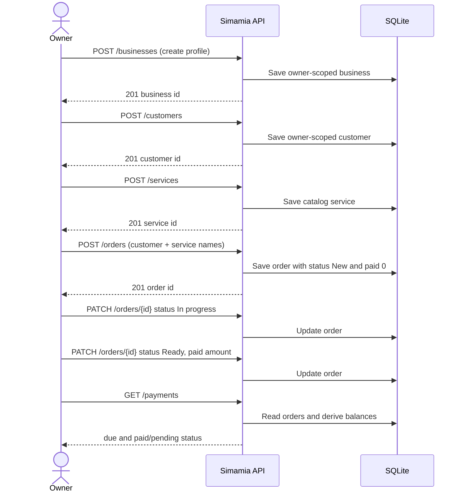

# Create and complete a job

This guide walks through a common service flow. The API stores customer/service relationships as names, so keep those values consistent in your client.



## Step 1: Create or select the business

The app usually creates the profile during first-use onboarding. For API integrations, call `POST /businesses` with `businessName`, `phone`, and `primaryTemplate`. See [business profile](/api/businesses).

## Step 2: Create the customer and service

Create a customer with `name` and `phone`, then create a service with `name` and a positive `price`.

```bash
curl -X POST "$SIMAMIA_API/customers" -H "Authorization: Bearer $SIMAMIA_TOKEN" \
  -H 'Content-Type: application/json' \
  -d '{"name":"Asha Mushi","phone":"+255 712 345 678"}'

curl -X POST "$SIMAMIA_API/services" -H "Authorization: Bearer $SIMAMIA_TOKEN" \
  -H 'Content-Type: application/json' \
  -d '{"name":"Wash and fold","price":25000,"category":"Laundry"}'
```

Save the IDs from both responses in your application. The current order schema does not accept foreign-key relationships as a requirement; it uses the display names below.

## Step 3: Open the work order

```bash
curl -X POST "$SIMAMIA_API/orders" -H "Authorization: Bearer $SIMAMIA_TOKEN" \
  -H 'Content-Type: application/json' \
  -d '{"customer":"Asha Mushi","service":"Wash and fold","date":"2026-10-12T09:00:00+03:00","amount":25000,"status":"New","paid":0,"method":"Not paid"}'
```

The API returns an ID such as `ORD-0249`. It adds `currency: TZS`, `status: New`, and `paid: 0` when omitted.

## Step 4: Update job state

Use `PATCH` as the work proceeds:

```bash
curl -X PATCH "$SIMAMIA_API/orders/ORD-0249" \
  -H "Authorization: Bearer $SIMAMIA_TOKEN" \
  -H 'Content-Type: application/json' \
  -d '{"status":"In progress"}'

curl -X PATCH "$SIMAMIA_API/orders/ORD-0249" \
  -H "Authorization: Bearer $SIMAMIA_TOKEN" \
  -H 'Content-Type: application/json' \
  -d '{"status":"Ready"}'
```

The API accepts arbitrary status strings. Define your allowed labels in the UI/template and validate transitions in your integration until server-side workflow rules are available.

## Step 5: Record a balance update

After an actual payment has been independently confirmed, patch the order's `paid` and `method` fields:

```bash
curl -X PATCH "$SIMAMIA_API/orders/ORD-0249" \
  -H "Authorization: Bearer $SIMAMIA_TOKEN" \
  -H 'Content-Type: application/json' \
  -d '{"paid":10000,"method":"M-Pesa"}'
```

The API itself does not verify a mobile money receipt or initiate collection. Re-read `GET /payments` to inspect the derived balance.

## Step 6: Close, query, or remove

Mark the order complete with `PATCH /orders/{id}`. Read the resulting balance using `GET /payments`. Use `DELETE /orders/{id}` only when you intend to permanently remove the order and its derived balance row.

## Error handling and retries

Use `meta.request_id` to correlate each operation. If a create call times out, the API has no idempotency key; check the list before submitting again to avoid duplicate work records. See [response semantics](/concepts/responses-errors).
