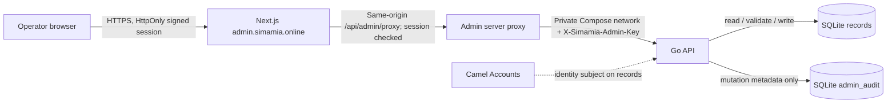

# Simamia Admin Console

The private operator console runs at `https://admin.simamia.online`. It provides a platform overview, inferred Simamia tenant list, tenant-scoped CRUD for every persisted business resource, SQLite usage metrics, and a durable audit trail.

## Architecture



The admin app has a separate operator email and password; it does not use Camel Accounts login and it does not expose the API key to browser code. Configure `SIMAMIA_ADMIN_EMAIL` and `SIMAMIA_ADMIN_PASSWORD` on the server. Camel Accounts remains the authority for user credentials, Google connections, and identity lifecycle. Simamia currently derives tenant accounts from `owner_sub` values present in business records; it has no first-class account/membership table.

## Admin screens

- **Overview:** distinct inferred tenants, total records, and counts for businesses, customers, services, jobs/orders, team, and expenses.
- **Accounts:** searchable owner subjects, business name when a profile is present, and per-resource counts.
- **Business records:** choose a tenant and resource, search the current records, create, edit, or permanently delete records. The editor supports each resource's flexible JSON payload. Required field and positive amount/price validation matches normal API writes.
- **Usage:** total records, serialized payload size, creations in the last 30 days, latest update per resource, and admin mutation count. Payload byte counts exclude indexes, WAL files, and backups.
- **System health:** Go API status, SQLite connectivity, Camel Accounts configuration, admin endpoint configuration, and API uptime. It is a database/process check, not a live probe of Camel Accounts or a log viewer.
- **Audit log:** latest admin creates, updates, and deletes, including operator, target tenant, resource, record ID, time, and changed property names. It deliberately excludes property values.

Payments are derived from orders and cannot be edited directly. There is no hard-delete-all-tenant action. Delete records individually, with a browser confirmation. Record deletion is permanent; SQLite backups are the recovery path.

## Endpoints

All endpoints below are relative to `https://api.simamia.online/api/v1`. They require:

```http
X-Simamia-Admin-Key: <SIMAMIA_ADMIN_API_TOKEN>
```

Never call these endpoints with the admin key from browser JavaScript. The admin Next.js proxy adds it after checking the signed operator session. Lists accept `page` and `page_size` (default 50, maximum 200); tenant resource lists also accept case-insensitive `q`.

| Method | Path | Behavior |
| --- | --- | --- |
| GET | `/admin/overview` | Global account and resource totals |
| GET | `/admin/accounts?q=&page=&page_size=` | Tenants inferred from `owner_sub` values on stored records |
| GET | `/admin/accounts/{owner_sub}` | Tenant summary and its business profiles |
| GET, POST | `/admin/accounts/{owner_sub}/{resource}` | List or create one tenant's resource records |
| GET, PATCH, DELETE | `/admin/accounts/{owner_sub}/{resource}/{record_id}` | Read, shallow-merge update, or permanently delete one record |
| GET | `/admin/usage` | SQLite record counts, payload byte estimates, 30-day creations, and last-updated timestamps |
| GET | `/admin/health` | API/database health and configured service states; does not probe Camel Accounts |
| GET | `/admin/audit?page=&page_size=` | Newest administrator mutation events |

`resource` must be one of `businesses`, `customers`, `services`, `orders`, `team`, or `expenses`. `payments` is intentionally not accepted for CRUD because it is a derived view. The API owns `id`, `owner_sub`, and (for business profiles) `ownerSub`: create assigns them, and update ignores attempts to change them. Resource validation runs after merging patches.

### Example: read the overview

```sh
curl -H "X-Simamia-Admin-Key: $SIMAMIA_ADMIN_API_TOKEN" \
  https://api.simamia.online/api/v1/admin/overview
```

### Example: list customer records for a tenant

```sh
curl -G \
  -H "X-Simamia-Admin-Key: $SIMAMIA_ADMIN_API_TOKEN" \
  --data-urlencode 'q=asha' \
  --data-urlencode 'page=1' \
  --data-urlencode 'page_size=50' \
  "https://api.simamia.online/api/v1/admin/accounts/$OWNER_SUB/customers"
```

### Example: add an expense

```sh
curl -X POST \
  -H "X-Simamia-Admin-Key: $SIMAMIA_ADMIN_API_TOKEN" \
  -H 'Content-Type: application/json' \
  --data '{"description":"Shop supplies","category":"Supplies","amount":12500,"date":"2026-10-11","currency":"TZS"}' \
  "https://api.simamia.online/api/v1/admin/accounts/$OWNER_SUB/expenses"
```

## Configure and run

Set these server-side variables in `.env` before starting Compose. Use different random values for all three secrets. Do not put them in `NEXT_PUBLIC_*` variables or commit `.env`.

```dotenv
SIMAMIA_ADMIN_EMAIL=<private operator email>
SIMAMIA_ADMIN_PASSWORD=<long private operator password>
SIMAMIA_ADMIN_API_TOKEN=<at least 32 random characters>
SIMAMIA_ADMIN_SESSION_SECRET=<different random secret, at least 32 characters>
SIMAMIA_ADMIN_ACTOR=platform-operator
ADMIN_APP_ORIGIN=https://admin.simamia.online
```

Generate independent values with:

```sh
openssl rand -base64 36
```

Then build and start the admin service with the same Compose command used by the product:

```sh
docker compose up -d --build admin api caddy
```

If host Nginx owns ports 80/443, use `deploy/compose.vps.yaml` and install `deploy/nginx-simamia.conf`; that proxy sends `admin.simamia.online` to loopback port `4176`. Obtain a TLS certificate for the admin hostname with the same Certbot setup as the other Simamia hosts.

For local development, start the admin Next app on port 3001 from `admin/`. Provide `SIMAMIA_API_URL=http://localhost:8080/api/v1`, `SIMAMIA_ADMIN_EMAIL`, `SIMAMIA_ADMIN_API_TOKEN` (matching API's `SIMAMIA_ADMIN_TOKEN`), `SIMAMIA_ADMIN_PASSWORD`, `SIMAMIA_ADMIN_SESSION_SECRET`, and `ADMIN_APP_ORIGIN=http://localhost:3001`. The Go API needs a persistent SQLite database; its admin routes return `ADMIN_REQUIRES_DATABASE` when using the in-memory preview store.

## Security and operating limits

- The Go API returns `ADMIN_DISABLED` unless `SIMAMIA_ADMIN_TOKEN` has at least 32 characters. A wrong key returns `ADMIN_UNAUTHORIZED`.
- The console session is an eight-hour HMAC-signed, HttpOnly, SameSite=Strict cookie. Production sets `Secure`.
- Login and mutation requests enforce the configured exact admin origin. The login process applies an in-memory per-IP retry throttle; restarting the admin container clears this short-lived counter.
- The API key is a shared machine credential. Audit entries use `SIMAMIA_ADMIN_ACTOR` as a shared actor label, not a distinct operator identity. Do not share the password if attributable individual audit records are required.
- Admin routes are externally routable on the API host but remain protected by the high-entropy API key; only the admin server should hold it. Keep API and admin containers on the private Compose network.
- List of accounts is derived only from records, so a Camel Accounts identity with no Simamia record will not appear. This console cannot suspend or edit Camel Accounts users.
- CRUD uses permanent deletes and existing schema rules. There are no soft-delete, restore, account lock, approval, or data export workflows yet.
- Audit writes are attempted after a successful record write. If SQLite fails while recording audit metadata, the business mutation remains committed and an `admin_audit_write_failed` server log is emitted; operators should alert on this event.
